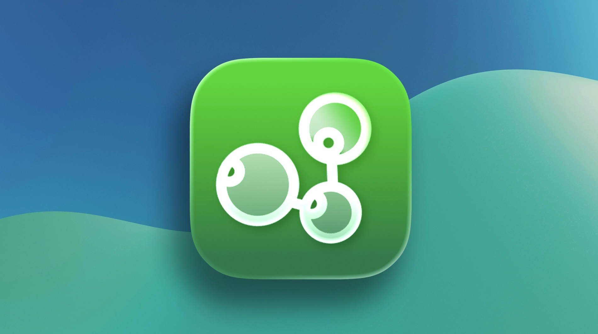
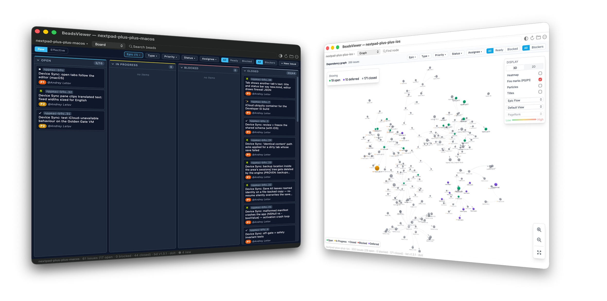
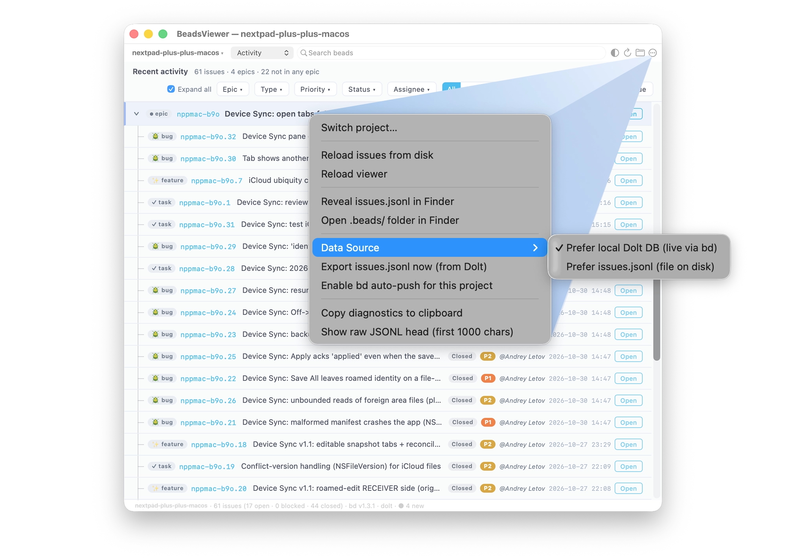
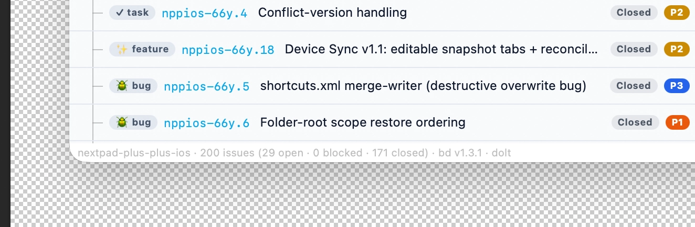
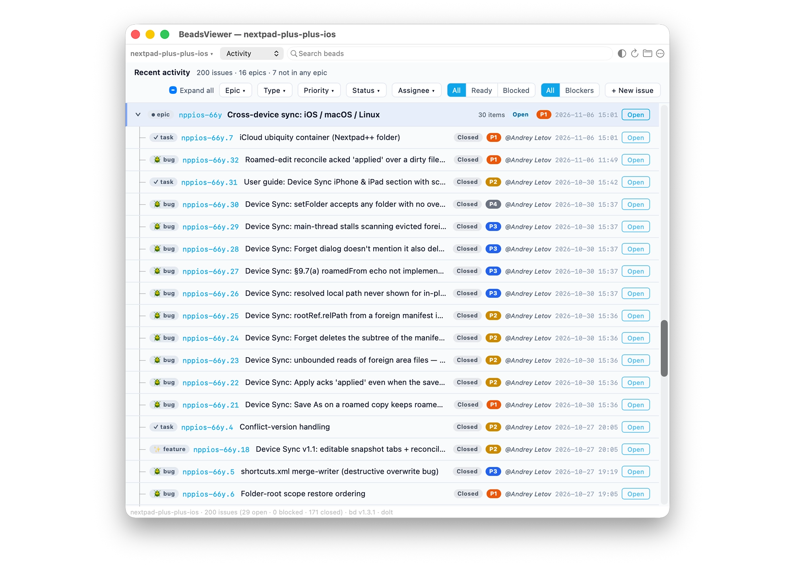
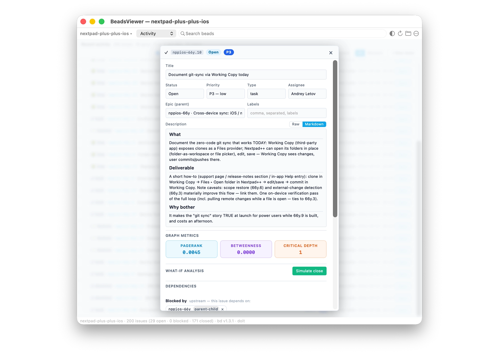
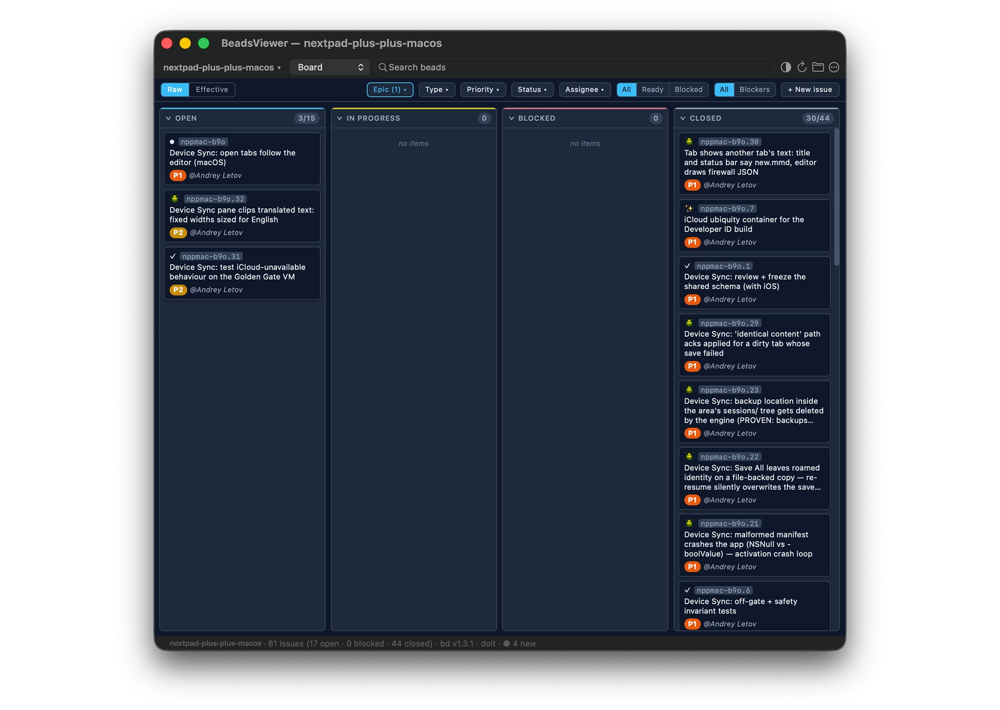
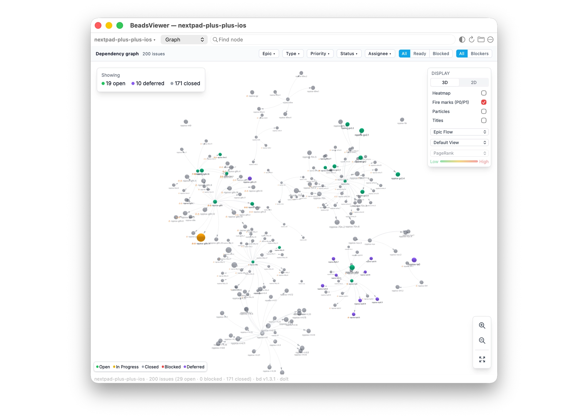
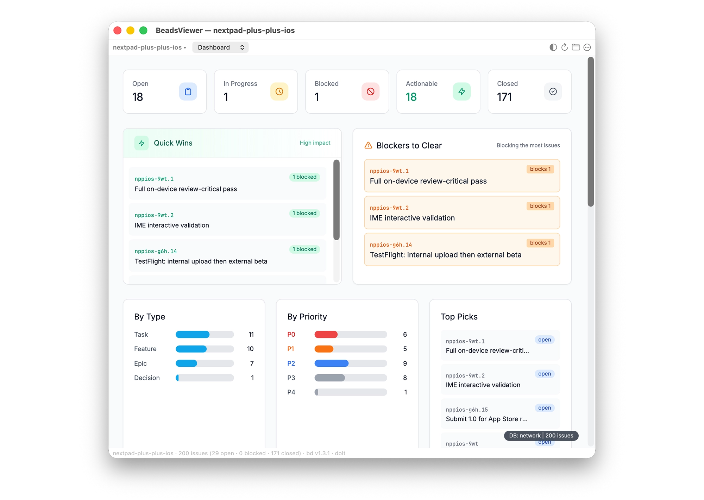
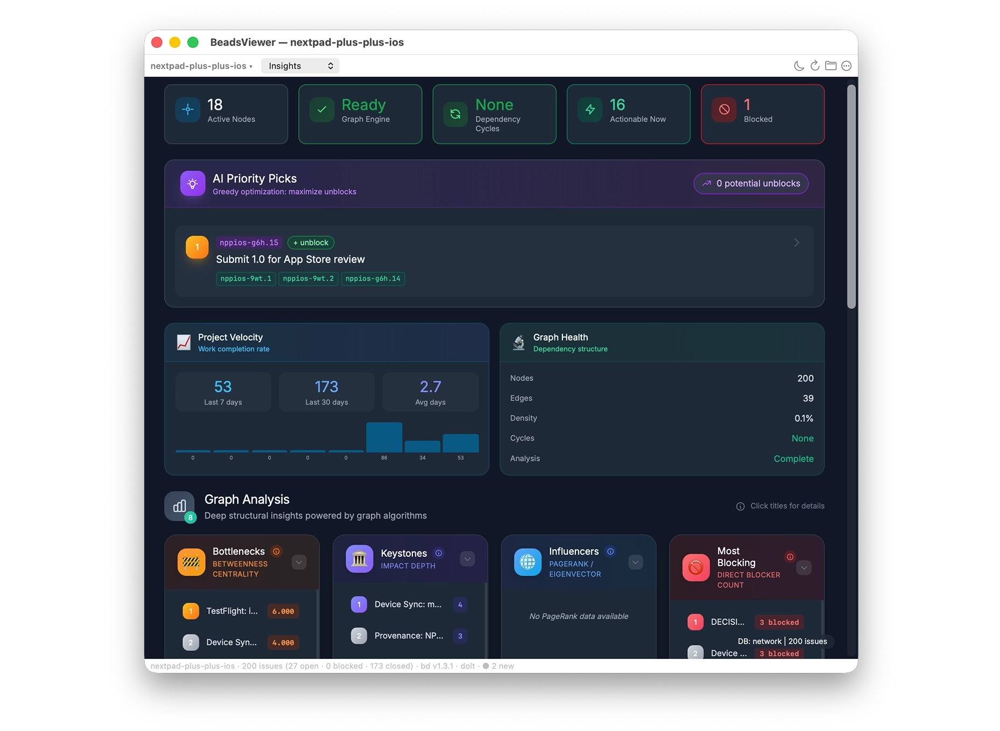

 <download-button href="https://nextpad.org/beads/" variant="primary" icon="download">Download Beads Viewer 1.0.1 (Universal DMG)</download-button>
 <download-button href="https://github.com/nextpad-plus-plus-plugins/NppBeads.macos" variant="secondary" icon="github">NppBeads Source on GitHub</download-button>

# Beads Viewer 0.9

Back in April I released the first [Beads Viewer for Nextpad++ and macOS](https://nextpad.org/news/?slug=NppBeads). That post explains what Beads is and why an issue tracker built for AI agents works differently from one built for people in a browser. If you haven't read it, the short version is this: Beads keeps your issues in a small database inside your repo, agents read and write it with a fast command line tool called `bd`, and nobody needs a login, a server, or an API token.

A lot has changed since then. I've been running Beads Viewer every day on my own projects, usually four or five at a time, with agents working on some of them while I'm busy with others. Most of what's new came from that: I needed to see what was going on everywhere without opening a terminal, and I needed to fix things quickly when an agent filed something in the wrong place.

So this post is less about Beads itself and more about how to use the updated Beads Viewer to keep track and manage several projects at once. The current version is **1.0.1**, for both the standalone Mac app and the Nextpad++ plugin. They're the same code and look the same and free forewer. I feel that with time Beads Viewer and Beads may completely replace Jira for some teams as I enhance Beadv Viewer with more enterprise team features. 

## Why I call it a Jira for AI

I keep coming back to the Jira comparison because that's the question people ask me first: "can this replace our tracker?" For a team where agents do most of the work, I think the answer is yes. Here's how the pieces line up.

| What you use in Jira | What you use in Beads Viewer |
|---|---|
| A project | A repo with a `.beads/` folder. In the Mac app, each project gets its own window. |
| Epics, stories, tasks, bugs | The same idea: epic, feature, task, bug, chore and decision. Issues sit under an epic, and epics can sit under other epics. |
| The board | The **Board** view. Drag a card to change its status. |
| JQL and saved filters | The filter bar: Epic, Type, Priority, Status, Assignee, Ready / Blocked and Blockers, plus search. |
| Dashboards | The **Dashboard** and **Insights** views. |
| Issue links | Ten link types (blocks, parent-child, discovered-from and so on), drawn in the **Graph**. |
| Notifications | The "● N new" counter at the bottom of the window. |
| "Assign to me" | **Claim**. It sets you as the assignee and moves the issue to In Progress in one step, and refuses if someone else got there first. |
| History and audit log | Every change is a commit in the Dolt database that lives in your repo. |

The big difference is who writes. In Jira almost every ticket is typed by a person. With Beads, the agents file most of the issues, update them as they go, leave comments about what they tried, and close them when the work is merged. You file the important things (the epics, the bugs only you understand, the decisions) and spend the rest of your time reading. Beads Viewer is built for that reading.

It's also fast in a way a web tracker can't be. A status change is a local database write that takes milliseconds, so an agent can update its issues as often as it likes without waiting on rate limits or a server.

There are still things Jira does that Beads doesn't try to do, and I list them near the end.

## One window per project

The standalone Mac app opens each project in its own window. That sounds like a small thing, but it changes how you work with several projects.

- **File › Open Project Folder…** (⌘O) opens a project in a new window. Pick the project folder or the `.beads` folder inside it.
- **File › Open Recent** lists the projects you've opened before.
- Right-click the Beads Viewer icon in the Dock and choose **New Window** for an empty window.
- If a project is already open, opening it again just brings its window forward. You won't end up with two windows fighting over the same project.
- Each window remembers its own size and position, per project. Put the iOS project on the left monitor once, and that's where it opens next time.

 *Manage and monitor multiple projects*

In Nextpad++ the plugin works a little differently. The panel follows the file you're editing: open a file from another repo and the panel switches to that repo's issues. You can also pick a project from the project name at the top left of the panel.

## Keeping up with what changed

When you watch several projects, the real question is always "what happened since I last looked?" Beads Viewer answers it in a few ways.

**Live updates.** With `bd` 1.3 or newer, Beads Viewer can follow the project's events journal and update about a second after anything changes, whether you made the change, an agent did, or a teammate did from the command line. The first time you open a project, it asks:

 *Live Updates*

Say yes and it turns on the journal for that project (`bd config set events-journal true`). That setting is saved in the project's `.beads/config.yaml`, which may be in git, so your teammates' copies will have it too. If you say no, or you're on an older `bd`, the viewer checks for changes every two seconds instead. Either way it keeps up on its own.

One thing to know when you have many windows open: only the window you're working in updates live. The other windows note that something changed and catch up the moment you click into them. That keeps a dozen open windows from running a dozen `bd` processes in the background.

**The "● N new" counter.** The bar at the bottom of each window shows the project, its issue counts, your `bd` version, and a count of issues that changed since you last looked at Activity. Open Activity and it resets.

 *Status bar*

**Your filters stay put.** Activity, Board and Graph each remember their own filters for each project while the app is open. Set the Board to show only one agent's work, switch to the Graph to look at something, come back, and the Board is still filtered. Quit the app and everything starts fresh next time.

### A few setups that work for me

**The morning check.** Open each project from Open Recent and look at the Dashboard: the counts, what's blocked, the top picks. Then open Activity, which shows everything that moved overnight, newest first. It takes a couple of minutes for four projects.

**Watching an agent.** On the Board, set **Assignee** to the agent's name. Now you have that agent's own board: what it has claimed, what it finished, what's stuck. Agents show up under whatever actor name they write with, so give each one its own name and you can follow them separately.

**What's next.** In Activity, choose **Ready**. You'll see only issues with nothing still open blocking them, which is the same list `bd ready` gives an agent. If that list is empty, your agents are about to run out of work. Choose **Blockers** to see the open issues that other open issues are waiting on. Those are the ones worth a closer look.

**A second monitor.** Put two or three project windows side by side on another screen. Click whichever one you want to check and it updates right away.

## What's new in each view

There are five views now: **Dashboard**, **Insights**, **Activity**, **Board** and **Graph**. The old Issues list is gone. Activity does everything it did and more, and every issue link in the other views (a Dashboard card, an Insights list, a Graph node) opens the issue right inside Activity.

### Activity: issues grouped by epic

Activity used to be a plain list of recent changes. Now it groups issues under their epics, the way you'd lay out work in Jira. Each epic is a row you can fold, with its issues indented underneath it as a tree. Sub-epics nest inside their parent epics, and anything that isn't in an epic goes into a "Not in any epic" group at the bottom. Epics are sorted by their most recent change, so the busiest work is at the top. **Expand all** opens or folds everything at once.

 *Activity View*

The filter bar across the top is the same one the Board and Graph use: **Epic**, **Type**, **Priority**, **Status**, **Assignee**, **All · Ready · Blocked** and **All · Blockers**. The Epic filter shows an epic and everything under it, however deep. Pick two epics and you see both.

Hover a row to see the start of the description and a few quick facts. Click a row, or its **Open** button, and the issue opens in a window on top of the list.

### The issue window

This is where you read and change an issue. It works the same from Activity and from the Board.

Everything is editable in one place: title, status, priority, type, assignee, labels and the description. The description has a **Raw | Markdown** switch, so you can read it formatted or edit the text. Below that are the dependencies, the comment thread and the buttons: Close (or Reopen), Claim, Delete, Cancel and Save.

**Moving an issue to another epic.** This is new in 1.0.1, and it's the change I asked myself for most often. Agents sometimes file an issue under the wrong epic, or the work turns out to belong somewhere else. Now there's an **Epic (parent)** field next to Labels. Pick another epic and save, and the issue moves, along with anything nested under it. Choose "— none —" to take it out of its epic. The new link is added before the old one is removed, so if something goes wrong the issue keeps its old epic.

 *Edit any bead (Assign parent, add comments, re-open, deffer, etc.*

The same field is on the **+ New issue** form, so you can file new work straight into an epic. The form also lets you set what the new issue is blocked by and what it blocks.

**Graph metrics and "Simulate close".** The issue window now shows the issue's PageRank, betweenness and critical depth, and has a **Simulate close** button. Click it and you'll see what closing this issue would free up: which issues become ready right away, what opens up further down the chain, and which waiting issues would still be blocked, and by what. It's a quick way to decide what to work on, or what to tell an agent to work on.

### Board: the same filters

The Board now has the full filter bar from Activity. Filter it to one epic and it becomes that epic's board. Filter it to one assignee and it's that person's, or that agent's, board. While a filter is on, the column counts show what's shown out of the total, like **3/19**.

 *Board view (Kanban)*

The **Raw / Effective** switch is still there. Raw puts each card in the column for the status someone actually set. Effective also moves an open card into Blocked when something it depends on is still open, which matches what `bd ready` thinks. I leave it on Effective most of the time.

### Graph: 3D, epics, and live App

The Graph got the biggest update.

**It's 3D now**, with a 3D / 2D switch in the Display panel. Drag to turn it around, scroll to zoom. On a large project, 3D makes clusters much easier to see than a flat picture.

 *Working in the Live App/Plugin*

**Epic Flow** is a new way to draw the graph. Normally the lines show what blocks what. In Epic Flow they show which issues belong to which epic instead, so each epic gathers its issues around it, and you can see at a glance how big each piece of work is and how much is done.

 *Adjust settings and filters in Graph View to see your entire Project*

**Titles.** Tick **Titles** in the Display panel and every issue shows its title under its id, in 2D and 3D. Leave it off on a big project and turn it on when you've narrowed things down.

**Find and filter.** The search field at the top becomes **Find node** on the Graph: type an id or a few words and the graph shows the matches and whatever they're directly linked to. The filter bar works here too, including the Epic filter. The box at the top left tells you how many open, deferred and closed issues are on screen.

**It updates live.** This was the main fix in 1.0.1. The Graph, Dashboard and Insights used to show the data they had when you opened them, so a status change didn't appear until you switched views and came back. Now they refresh as soon as something changes, and the Graph keeps its layout, zoom and filters while it does. A node simply changes color when an agent closes it.

### Dashboard and Insights

The Dashboard still gives you the quick overview: counts by status, top picks, quick wins, the issues blocking the most work. The counts are clickable now. Click **Blocked** and Activity opens filtered to blocked issues. The Blocked and Actionable numbers count only blockers that are still open, so they match what you see in Activity.

 *Dashboard View*

Insights keeps the graph analysis (PageRank, betweenness, critical path, k-core, articulation points, cycles), and its "unlocks the most" list was fixed in 1.0. Before that it was working out the answer backwards.

 *Insights View*

## It reads straight from the database

One change you won't see but will notice: Beads Viewer now reads issues straight from the project's database through `bd`, instead of from the `issues.jsonl` export file. Newer versions of `bd` don't rewrite that file after every change, so a viewer reading the file could fall behind. Reading from the database keeps it current.

If you need the old behavior, for example when a teammate pushed an `issues.jsonl` you want to look at before importing it, the **⋯** menu has a **Data Source** choice per project, and an **Export issues.jsonl now** item. The bottom bar shows which source you're using: `· dolt` or `· jsonl`.

## Getting it

- **Mac app:** download the [DMG](https://nextpad.org/beads/) and drag Beads Viewer to Applications.
- **Nextpad++ plugin:** install or update **Beads** from **Plugins › Plugins Admin**, then restart Nextpad++.
- **The `bd` command line tool:** `brew install beads`, or `brew upgrade beads` if you already have it. Live updates need `bd` 1.3 or newer. Older versions still work and fall back to checking every two seconds.

Both run on any Mac with macOS 11 or newer, Apple silicon or Intel, and both are signed and notarized by Apple.

## What it doesn't do (yet)

I'd rather you hear this from me than find out halfway through a move from Jira.

- **No sprints, story points.** Beads tracks work and the order it has to happen in, not estimates. Labels cover some of it. With AI these estimates can be expressed in tokens burned versus estimated and cost, which may be a better idea.
- **No permissions.** Anyone who can write to the repo can write to the issues. That's fine for one person with a few agents, or a small team. It isn't enough if different departments need to see different things.
- **One project per window.** There's no single view of open work across all your projects yet. You open a window for each one.
- **Background windows catch up when you click them.** As described above, only the window you're working in updates live. This can be easily changed.
- **Comments don't refresh while an issue is open.** If an agent posts a comment while you have that issue open, close and reopen it to see the comment.

## 

If you run agents on real projects, try it on one of yours. File a few epics, let an agent work through them, and leave Beads Viewer open on the side or ask your agents to create beads and Epics for your entire project. I'd like to hear what you would want to have in Beads Viewer as a builder and also as a manager who manages and monitors projects.
