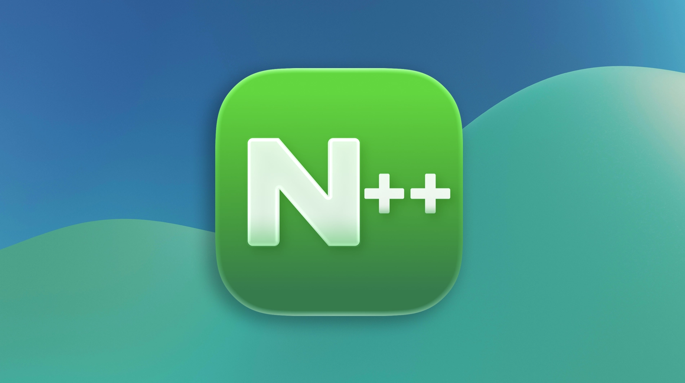

# Device Sync - User Guide

*Nextpad++ 1.1.3 for macOS · Nextpad++ for iPhone & iPad · November 2026*

Device Sync lets you walk away from your Mac mid-thought and pick up the same tabs — including unsaved ones — on your iPhone, iPad, or another Mac, then bring the edits back. It is built around one rule: **nothing leaves your machine until you turn it on, and nothing is shared except what you see in your tab bar.**

---

## 1. How it works (one minute)

Every device you enable Device Sync on **publishes** its open tabs — names, cursor positions, and the content of unsaved files — into one shared folder you choose, called the **sync area**. Your sync service (iCloud Drive, Dropbox, Syncthing, a network share — anything that syncs a folder) carries that folder between your devices.

Each device writes only to its own corner of the area and never touches another device's data. Sessions are **never merged automatically**: when you want another device's tabs, you ask for them, see exactly what will open, and confirm. When another device edits one of *your* tabs, nothing is applied until you approve it.

A few consequences of this design worth knowing up front:

- **Off means off.** With Device Sync off, Nextpad++ behaves exactly like a build without the feature — no reads, no writes, no prompts.
- **Your files stay where they are.** Device Sync doesn't move, copy, or   upload your documents. Files travel only as *snapshots inside the sync area*, and only for tabs you actually have open.
- **No accounts, no servers, no credentials.** The sync area is just a folder. Nextpad++ never stores passwords, tokens, or keys in it.

---

## 2. Turning it on

Open **Settings ▸ Preferences… ▸ Device Sync**.

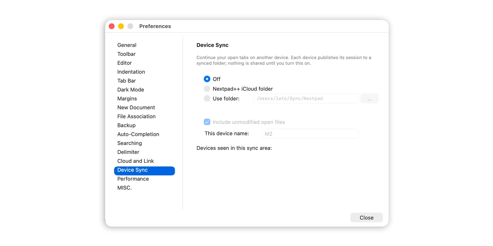

1. Pick where your sync area lives:
   - **Nextpad++ iCloud folder** — the app's own folder in iCloud Drive. Easiest if all your devices use the same Apple ID: there's no folder to pick ([details](#using-icloud-drive-across-your-devices)). Requires iCloud Drive to be on; if it isn't available, the pane tells you in red and you can use a folder instead.
   - **Use folder:** — any folder that your devices share by other means: Dropbox, Google Drive, Syncthing, Resilio, a NAS. Press **…** and pick the *same* folder (per the service) on every device.
2. Check **This device name** — it's how this Mac appears on your other devices. The default is your computer's name; make it friendly.
3. Leave **Include unmodified open files** on if you want clean (saved, unedited) tabs to carry their content too, so they open even on devices that can't reach the original file. Turn it off and clean tabs sync as references only.

That's it. The Mac publishes within seconds and republishes automatically: on every save, when you switch away from the app or quit, and at most every 15 seconds while you edit. Other devices appear under **Devices seen in this sync area** as soon as their data arrives:

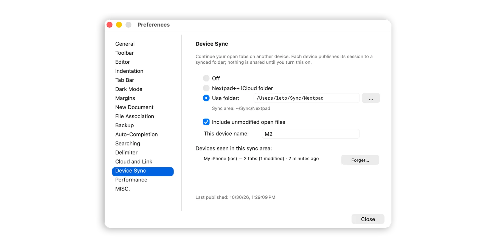

> **Tip — picking a good folder.** Use a dedicated, mostly-empty folder
> (e.g. `~/Dropbox/Nextpad Sync`). Nextpad++ refuses folders that would
> collide with its own data — see [§10](#10-how-device-sync-plays-with-other-settings).

### Using iCloud Drive across your devices

If your Mac, iPhone and iPad use the same Apple ID, this is the simplest setup, with no extra software and no folder to pick. iCloud Drive must be on for that Apple ID on every device.

1. On the Mac, open **Preferences ▸ Device Sync** and choose **Nextpad++ iCloud folder**.
2. On the iPhone and iPad, open **Preferences ▸ Device Sync**, tap **Sync between devices**, and choose **iCloud Drive (Nextpad++)**.
3. Give it a minute. Each device should appear under **Devices seen in this sync area** on the others.

A **Nextpad++** folder with the app's icon appears in iCloud Drive, in Finder and in the Files app. Nextpad++ manages it, so you don't need to open it.

**How long things take.** iCloud decides when files move, so allow anything from a few seconds to a couple of minutes. iPhones and iPads only pick up changes while Nextpad++ is open — see [Phone & tablet particulars](#phone--tablet-particulars).

---

## 3. Continuing from another device

When another device has published a session newer than the last one you looked at, a quiet card appears in the corner — it never opens anything by itself:

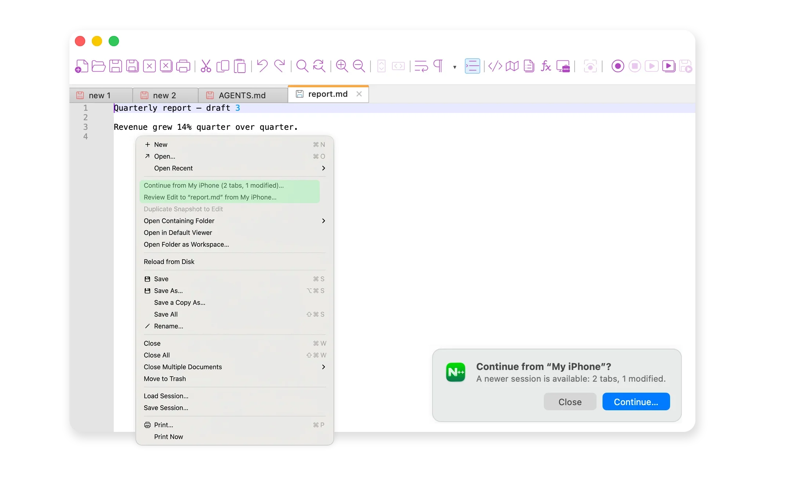

You can also start from the **File menu** at any time, which lists every device in the area:

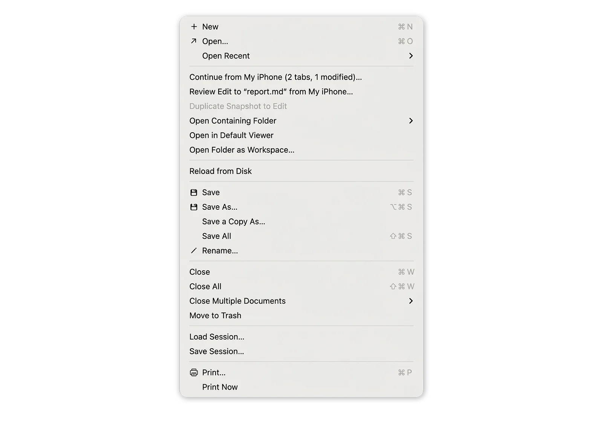

Either way, Nextpad++ first shows you exactly what would happen, tab by tab, and nothing opens until you press **Continue**:

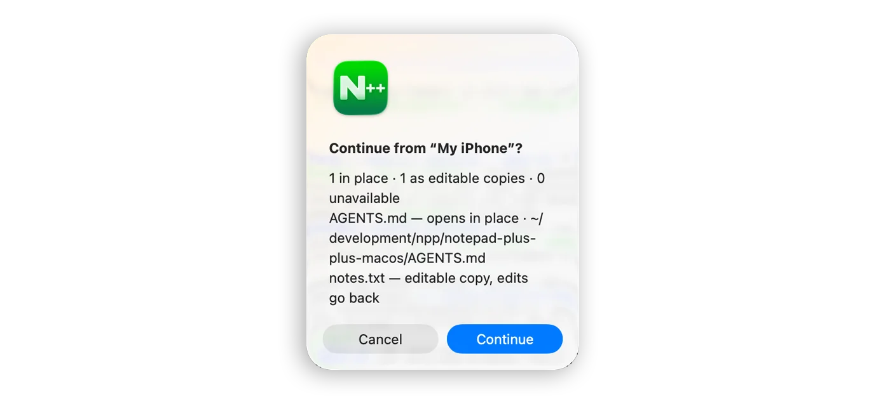

Each tab resolves one of three ways:

| Outcome | Meaning |
|---|---|
| **opens in place · \<path\>** | The same file exists here (same path, or a shared folder — see [§7](#7-sharing-folders-between-devices)), so the real file opens, with the cursor where you left it. The line shows the exact local path that will open. If the local file's content differs from what the other device saw, the line says **"local file differs"** so you know before opening. |
| **editable copy, edits go back** / **read-only from snapshot** | The file doesn't exist here, or it has unsaved changes on the other device — so its content opens as a *copy* in a new tab. If the other device's Nextpad++ can receive edits back, the copy is editable ([§4](#4-editing-another-devices-tabs)); otherwise it opens read-only, and **File ▸ Duplicate Snapshot to Edit** gives you a detached editable duplicate. |
| **only on that device** | The tab's content didn't travel (a very large file, a clean file with *Include unmodified* off, a sync still in flight, or a copy that device itself received from a third device), so there is nothing safe to open here. For a third device's tab, continue from that device instead. |

Unsaved ("dirty") tabs always resume from their snapshot — the unsaved edits are the point — and never overwrite the file on disk.

**Having the same file here doesn't make it open in place.** Tabs match by exact path or through a shared folder, and paths on a Mac, an iPhone and an iPad never match each other. A copy of `notes.txt` on your Mac and another on your iPhone are two separate files to Nextpad++, so a tab from one opens as a copy on the other. Edits to that copy go back to the device the tab came from: your own file with the same name is not changed. To work on one real file from every device, keep it in a shared folder ([§7](#7-sharing-folders-between-devices)).

Resuming never modifies the other device's data, and it *adds* tabs to your session; it never closes or replaces what you already have open.

---

## 4. Editing another device's tabs

When the other device can receive edits (any current Nextpad++), its copies open fully editable, marked in the tab title:

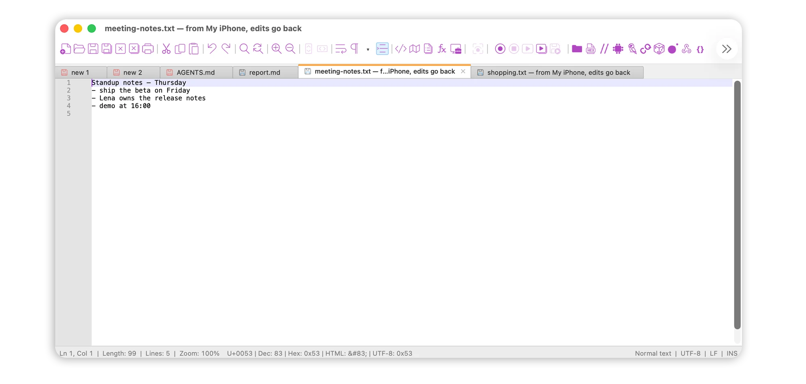

Work in it like any tab. When you **Save** (⌘S — or Save All, or the save prompt when closing), the edit is **sent back to the device the tab came from** instead of being written to a file here. The other device then decides what to do with it ([§5](#5-receiving-edits-back)) — your edit is never force-applied to it.

Details worth knowing:

- Saving a copy you haven't changed sends nothing.
- If you change your mind, undo back and save — the newer save supersedes the earlier one.
- **File ▸ Save As…** turns the copy into an ordinary local file. From that moment it belongs to this Mac: its saves go to disk, not to the other device.
- Once the other device accepts (or declines) your edit, the delivery is cleaned up automatically. If it accepted it, your copy's baseline moves forward, so further edits continue the chain without conflicts. If it declined, your copy keeps your text.
- **A copy doesn't update by itself.** If the tab changes on its own device or a third device edits it, your copy stays as it was. Choose **Continue from \<device\>** again to refresh it. That updates copies with nothing pending; a copy with unsaved changes, or with an edit the other device hasn't taken yet, is left alone. If you edit an out-of-date copy anyway, the other device warns before applying it ([§5](#5-receiving-edits-back)).
- **Forget device** also discards any edits of yours it hasn't picked up — the confirmation dialog tells you if there are any.

---

## 5. Receiving edits back

Now the mirror image: you edited this Mac's tab on your iPhone on the subway and later open the Mac. The moment you focus that tab (or switch back to Nextpad++), it asks:

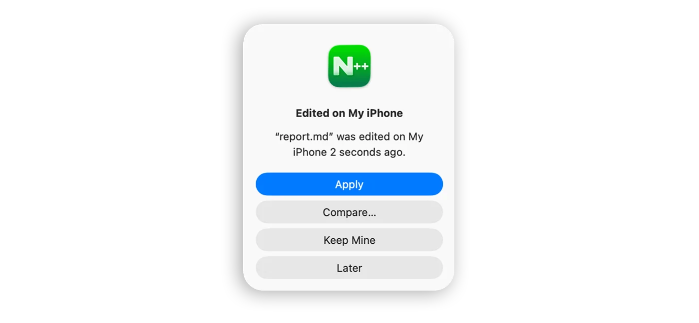

Only the tab in front prompts. If you're already looking at that tab when the edit arrives, switch away and back, or open **File ▸ Review Edit to "…" from \<device\>…**.

- **Apply** replaces the tab's content with the edit, as a single undoable step, and saves through the normal save path. If this tab also changed here in the meantime, the dialog warns you first and Apply is styled as destructive — nothing is ever merged silently, and last-writer never wins behind your back. If the tab is read-only here, the dialog says so and there is no Apply.
- **Compare…** opens the incoming edit side by side with your version (via the ComparePlus plugin), so you can merge by hand. Your tab stays the one that counts; the decision stays open until you Apply or Keep Mine. The button appears when ComparePlus is installed, and not for a tab in the horizontal split.

  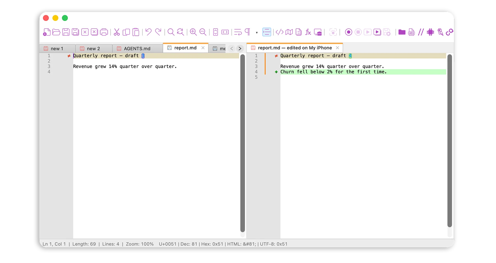

- **Keep Mine** declines the edit. The other device cleans up its copy.
- **Later** snoozes the prompt for this launch. Pending edits stay available under **File ▸ Review Edit to "…" from \<device\>…** — including edits to tabs you've since closed, which you can open as a file, take as a new tab, or discard.

If both devices ended up with *identical* saved content (you made the same fix twice), Nextpad++ acknowledges it silently — there is nothing to decide.

### When two devices edit the same tab

Say your Mac and iPad both edit an iPhone tab, neither seeing the other's change. The edits arrive one at a time. The first applies normally. The second warns that the tab has also changed here, because Apply would replace the first edit. Nothing is overwritten until you choose, and **Later** keeps the second edit waiting. **Compare…** is the way to keep parts of both.

### When the save fails

**Apply** puts the edit in the tab, then saves. If the file can't be written (a read-only file or folder, no permission, a disconnected drive), you get the normal save error and the tab stays unsaved. Your edit isn't lost:

- The sending device keeps its copy, and nothing is reported as applied.
- The edit stays in the tab, unsaved, through tab switches and a relaunch.
- It won't prompt again, because the tab already holds the edit.

Fix the cause and **Save**. The edit is acknowledged only once it has really reached the file.

---

## 6. On iPhone and iPad

Everything above works the same way in Nextpad++ for iPhone and iPad — same sync area, same rules, same edit prompts. This section shows where the pieces live on iOS and what differs on a phone or tablet.

### Turning it on

Open the toolbar's **… ▸ Settings ▸ Preferences… ▸ Device Sync** (with a hardware keyboard, ⌘,). Pick the sync area with **Sync between devices**:

- **iCloud Drive (Nextpad++)** — the app's own iCloud folder, the same one the Mac's **Nextpad++ iCloud folder** option uses ([setup steps](#using-icloud-drive-across-your-devices)). If iCloud Drive isn't available, the app tells you and you can choose a folder instead.
- **Choose Folder…** — the standard Files picker. Pick the *same* folder your other devices use: a shared folder in iCloud Drive, or the folder of any sync app that shows up in Files (Dropbox, Google Drive, Syncthing clients, and so on).

The rest of the pane matches the Mac: the **Include unmodified open files** toggle, **This device's name**, and every device seen in the area with **Forget…**. iPhone and iPad also have a **Publish Now** button, which the Mac doesn't need:

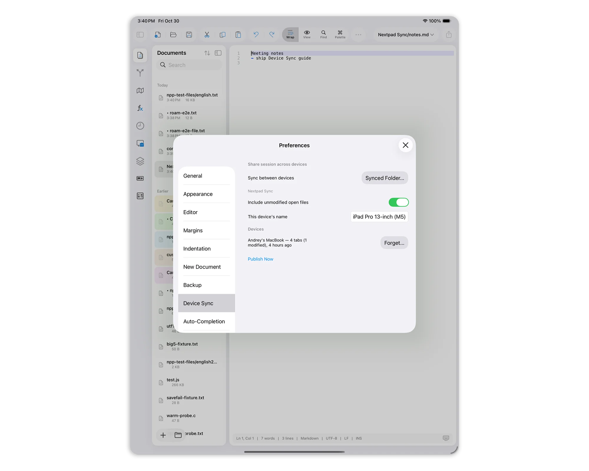

The iPhone and iPad publish on every save, when you switch to another app, and at most every 15 seconds while you edit — no step needed.

### Continuing from your Mac (or another device)

iPhone and iPad have no corner card: the File menu is the way in. Open the toolbar's **… ▸ File** menu and tap **Continue from \<device\>**. The confirmation shows every tab's outcome before anything opens — including the **exact location** every in-place tab would open from, in Files-app terms:

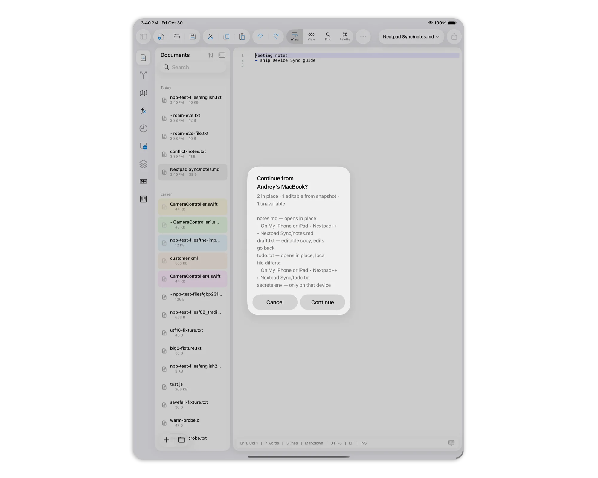

The outcomes are the same three as on the Mac ([§3](#3-continuing-from-another-device)): in place, a copy from a snapshot (editable when the other device can receive edits back, read-only otherwise), or "only on that device".

### Editing a Mac tab on the phone

An editable copy says exactly what it is, right under its title:

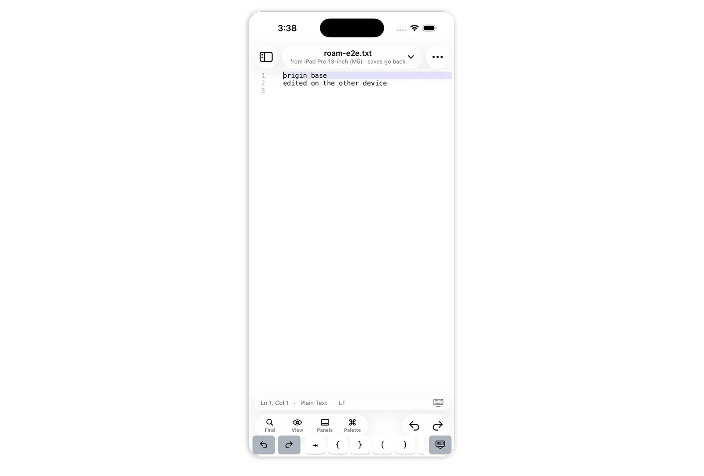

Edit it like any document and **Save** (the toolbar save button, or ⌘S with a hardware keyboard). The save travels back to the Mac instead of writing a file on the phone, and the Mac asks before applying it ([§5](#5-receiving-edits-back)).
**Save As…** turns the copy into an ordinary local file on this device, cut loose from the Mac. If a copy opens **read-only**, the other device's Nextpad++ is too old to receive edits — update it, or use **Duplicate to Edit** in the File menu.

### Receiving edits on the iPad

The mirror case — you edited an iPad tab on the iPhone, or a Mac edited one of the iPad's tabs. The moment the tab is focused, the same Apply / Compare… / Keep Mine / Later decision appears:

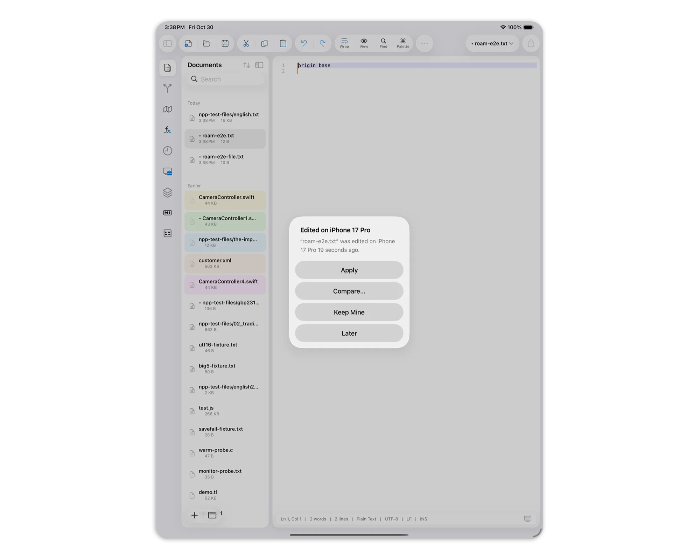

The tab has to be in front, so tap it if another tab is showing. **Later** keeps the edit waiting under **… ▸ File ▸ Review Edit from \<device\>**.

**Compare…** opens the side-by-side diff on iPad; on iPhone, rotate to landscape for the split view. Nothing is ever applied without you.

### iCloud file conflicts

Conflicts on files themselves ([§8](#8-icloud-file-conflicts)) get the same chooser:

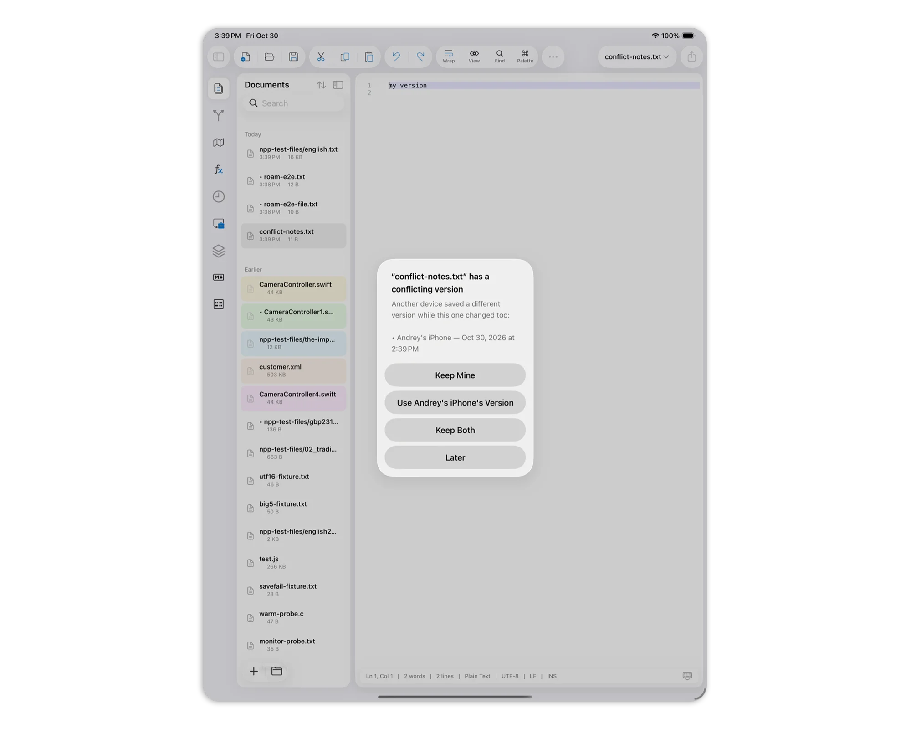

### Phone & tablet particulars

- **Syncing happens while Nextpad++ is open.** iOS suspends apps in the background, so the app publishes right when you switch away and re-scans the moment you come back — but it can't watch the folder while suspended. If a device seems stale, switch to Nextpad++ and give your sync app a moment.
- **Leaving the app saves.** Nextpad++ auto-saves the open document when you switch away. If a save can't succeed ([§5](#when-the-save-fails)), the same error can appear again each time you leave and return, until the cause is fixed.
- **Let Files finish.** With a third-party folder, iCloud Drive or a slow connection, the other device's data may still be downloading. Browsing the sync folder once in the **Files app** nudges iOS to download it; Nextpad++ also requests missing files and picks them up on the next scan.
- **Large files** never travel as snapshots (same rule as the Mac) — such tabs appear as "only on that device".
- **Privacy and Off are identical to the Mac** ([§9](#9-privacy--what-syncs-and-what-never-does)): Off means no reads, no writes, no menus, and the sync area never contains settings or credentials from any platform.

---

## 7. Sharing folders between devices

Files **inside the sync area itself** open in place on every device automatically — the area is shared by definition. Keep a notes folder in the area and every device edits the same real files, with the regular file-changed-on-disk handling you already know.

For folders *outside* the area that your devices also share (say, a Dropbox project folder), Nextpad++ can mark the folder so tabs from it resolve to the right local path on every device, even when the folder sits at different paths on different machines. When you add such a folder as a workspace
(**File ▸ Open Folder as Workspace…**) while Device Sync is on, Nextpad++ offers once to place a small marker file (`.nextpad-root`) in it. Decline and it never asks again for that folder; delete the marker file at any time to undo it.

---

## 8. iCloud file conflicts

If the *same file* gets edited on two devices while one is offline — classic iCloud Drive territory — iCloud keeps the losing version as a hidden "conflict copy". Most editors silently ignore it: last writer wins, the other edit vanishes.

With Device Sync on (and *File Status Auto-Detection* enabled in Preferences ▸ MISC.), Nextpad++ surfaces the conflict when you open or focus the file and offers: **Keep Mine**, **Use \<device\>'s Version**, **Keep Both** (the other version is saved next to the file as `name (conflict from <device> <date>).ext`), or **Later**. Every choice except Later marks the conflict resolved so it won't come back.

---

## 9. Privacy — what syncs and what never does

**Into the sync area goes:** your device's name, the list of open tabs (names, paths, cursor positions, language, encoding), and the content of open tabs as snapshots — unsaved tabs always, saved tabs only while *Include unmodified open files* is on. Edits you make to other devices' tabs travel the same way. **Everything in the area is readable by anyone who can read that folder** — it's your folder, protected exactly as well as you protect it (iCloud/Dropbox account, disk encryption, file permissions).

**What never enters the sync area:** your preferences and config.xml, themes, shortcuts, plugins, the session file, crash/auto backups, and credentials of any kind. Device identity lives only on each machine — settings synced by other means (see below) can never make two machines impersonate each other.

**Forget device** (Preferences ▸ Device Sync) removes a device's published data from the area — for a stolen or retired device, do this from any remaining device:

Forget clears the sync area only. Copies already open on another device stay there until they're closed on that device.

**Turning Device Sync off** stops all of it instantly: no publishing, no reading, no menus, no prompts. Already-published data from this device stays in the area until you Forget this device from another machine or delete the folder's contents yourself.

---

## 10. How Device Sync plays with other settings

**Backup location** (Preferences ▸ Backup). Backups are the only copy of your unsaved work and are deliberately **never synced** — they stay on each machine. You can move the backup folder anywhere *except* inside the sync area's `sessions` folder, which Nextpad++ manages and cleans automatically; both the Backup pane and Device Sync refuse that combination outright, so backups can never be eaten by sync housekeeping:

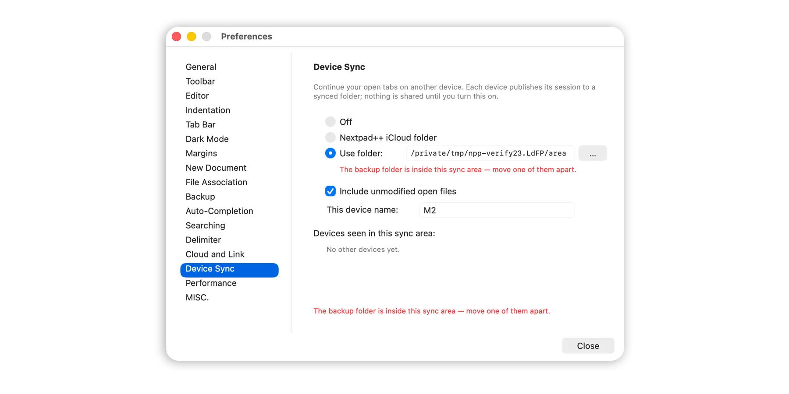

Placing the whole sync area inside your (custom) backup folder, or backups elsewhere inside the area, is allowed — just remember backups then travel with your sync service, which you may or may not want.

**Settings on cloud** (Preferences ▸ Cloud and Link). This older feature syncs your *settings* (config.xml and friends) via a cloud folder. It is fully independent of Device Sync: no Device Sync state is ever written into config.xml, so syncing settings between machines cannot clone a device identity or flip Device Sync on anywhere. You can even point both features at the same folder — they ignore each other's files — though separate folders are tidier.

**Session & crash recovery.** Your session (which tabs reopen at launch) and hot-exit backups remain strictly local and unchanged by Device Sync.

---

## 11. Troubleshooting

**My other device doesn't appear in the pane / File menu.**
The device list comes from the sync area, so one of three things is true: the other device hasn't published yet (open Nextpad++ there with Device Sync on), your sync service hasn't finished carrying its folder over (check the service's own status — big first syncs take a while), or the two devices aren't actually pointing at the same folder (compare the **Sync area** line on a Mac; on iPhone or iPad, re-pick the folder with **Choose Folder…** if you're unsure). Switching away from Nextpad++ and back re-scans the area.

**"N tab(s) skipped — snapshot not fully synced yet."**

Your sync service delivered the session description before the tab contents (or mid-upload). Nothing is wrong and nothing is guessed: Nextpad++ verifies every snapshot against its checksum and skips the ones that don't verify yet. Wait for the service to finish and Continue again.

**A red message under the folder field.**
- *Invalid path.* — the folder doesn't exist or isn't a folder. Pick it again with the **…** button.
- *iCloud is unavailable — choose a folder instead.* — iCloud Drive is off, or you're signed out of iCloud. Turn it on in System Settings, or use **Use folder:** with any synced folder.
- *This folder holds Nextpad++'s own settings — choose a different sync folder.* — you picked the app's data folder (or a parent of it). That would tangle sync with settings, sessions, and backups; choose a normal folder instead.
- *The backup folder is inside this sync area — move one of them apart.* — see [§10](#10-how-device-sync-plays-with-other-settings). Device Sync stays paused (nothing is written) until the overlap is resolved; fix it in either pane.

**"Last published" is old / nothing updates.**
Check for a red message (above). Then remember publishing is change-driven: if nothing changed in your session, nothing is rewritten. A save, an edit, or switching away from the app publishes immediately.

**The corner card ("Continue from …?") never shows up.**
The card only offers a session you haven't acted on yet — pressing **Close** or resuming marks that publish as seen until the device publishes something newer. The **File ▸ Continue from …** menu always works regardless.

**Tabs from my phone open read-only.**
The copy is editable only when the *other* device's Nextpad++ is new enough to receive edits back. Update it, or use **File ▸ Duplicate Snapshot to Edit** to work on a detached copy here.

**I edited a copy and saved, but the other device doesn't show my edit.**
The edit is applied there only after *you approve it on that device* — focus the tab there and answer the "Edited on …" prompt. If you dismissed it with **Later**, it waits under **File ▸ Review Edit…**. Both devices must also have synced since your save (check each side's sync service).

**An edit arrived, but nothing prompts.**
The prompt appears when the tab comes into focus, and only for the tab in front. Switch to that tab, or switch away from Nextpad++ and back. On a Mac, the edit is also listed under **File ▸ Review Edit…**; on iPhone or iPad, under **… ▸ File ▸ Review Edit from \<device\>**. If it isn't listed yet, iCloud or your sync app hasn't delivered it. On iPhone or iPad, opening the sync folder once in the **Files** app nudges the download.

**"The file couldn't be saved." or "Couldn't save" after Apply.**
Nothing is lost: the edit stays unsaved in the tab, and the other device keeps its copy. See [When the save fails](#when-the-save-fails). Fix the cause, such as a read-only file, a folder you can't write to, or a disconnected drive, then Save.

**The prompt says the tab has also changed here, but I didn't change it.**
Choose **Compare…** or **Later** rather than Apply, and check what's different. If you use one keyboard across a Mac and an iPad (Universal Control), keystrokes can land in the Mac's front tab by accident. If the change is just a stray keystroke, Apply is fine: Undo brings your version back.

**I have this file here too, but it opens as a copy.**
That's expected: see [§3](#3-continuing-from-another-device). Only a shared folder makes one file open in place on every device.

**My copy is out of date.**
Copies don't refresh by themselves. Choose **Continue from \<device\>** again. A copy with unsaved changes or an edit still waiting is left alone, so deal with those first ([§4](#4-editing-another-devices-tabs)).

**Two devices edited the same tab.**
Neither edit is lost. The second one warns before it can replace the first: see [When two devices edit the same tab](#when-two-devices-edit-the-same-tab).

**A tab says "only on that device".**
The tab's content didn't reach this device. It may be a very large file, a clean file with *Include unmodified open files* off, or a sync still in flight. If that device only has a copy of the tab from a third device, continue from the third device.

**"Couldn't send the edit to \<device\>."**
The sync folder wasn't reachable when you saved (disconnected drive, paused sync client, deleted folder). The tab stays modified so nothing is lost — fix the folder and save again.

**A tab says "opens in place, local file differs".**
The file on this Mac has different content than the other device last saw (you edited it here, or it changed on disk). Opening in place is still safe — it opens *your* local file. If you wanted the other device's version, it is the unsaved content of that device's tab; resume there or let it publish a save first.

**The same file keeps prompting "has a conflicting version".**
That's iCloud conflict handling ([§8](#8-icloud-file-conflicts)) and every choice except **Later** resolves it permanently. If you keep choosing Later, it will keep asking on focus — pick an answer.

**I restored this Mac from a backup / migrated to a new Mac, and two devices now show the same name or fight over one entry.**
A migrated Mac inherits the old one's sync identity. Give one of them a new name in the pane; if both machines are live and publishing over each other, turn Device Sync off on one, and use **Forget** from the other to clear the stale entry. (A cleaner re-identify action is on the roadmap.)

**I changed the sync folder — what happens to the old one?**
Nothing is deleted: the old folder keeps the last published data. Nextpad++ starts fresh in the new folder on the next publish. Clean the old folder up manually (or point each other device at the new folder and Forget stale entries).

**Something looks stuck mid-sync.**
Device Sync is deliberately conservative: when in doubt it skips, degrades to read-only, or waits — it never guesses content and never merges on its own. The pane's status lines (**Sync area** / **Last published**) plus your sync service's own UI almost always explain what it's waiting for.

---

## 12. Quick reference

| I want to… | Do this |
|---|---|
| Start syncing | Preferences ▸ Device Sync ▸ pick Nextpad++ iCloud folder, or Use folder: with a synced folder |
| Pick up my other device's tabs | File ▸ Continue from \<device\>… (or the corner card) |
| Edit a phone tab on the Mac | Just edit the copy and ⌘S — it goes back |
| Decide on an incoming edit | Focus the tab → Apply / Compare… / Keep Mine / Later |
| Review edits I postponed | File ▸ Review Edit to "…" from \<device\>… (iPhone/iPad: … ▸ File ▸ Review Edit from \<device\>) |
| Refresh an out-of-date copy | Continue from \<device\> again |
| Keep a copy as a normal file | File ▸ Save As… |
| Make a shared folder resolve everywhere | Add it as a workspace, accept the marker |
| Remove a device's data | Preferences ▸ Device Sync ▸ Forget… |
| Stop everything | Preferences ▸ Device Sync ▸ Off |
| Do all of this on iPhone/iPad | Same flows — see [§6](#6-on-iphone-and-ipad) |
