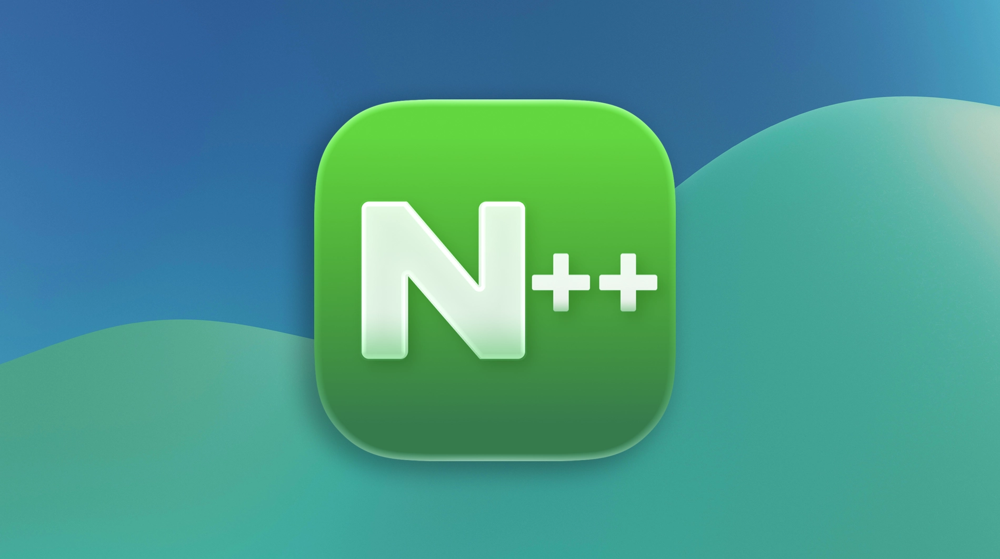
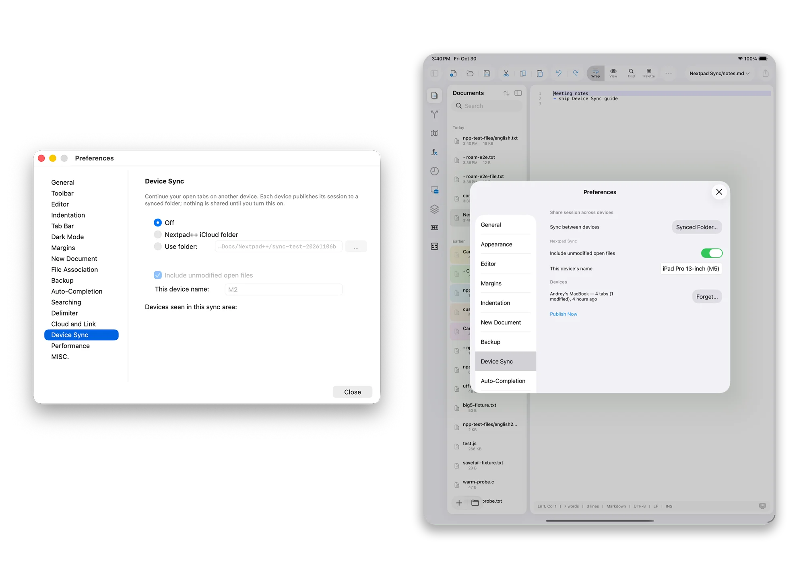
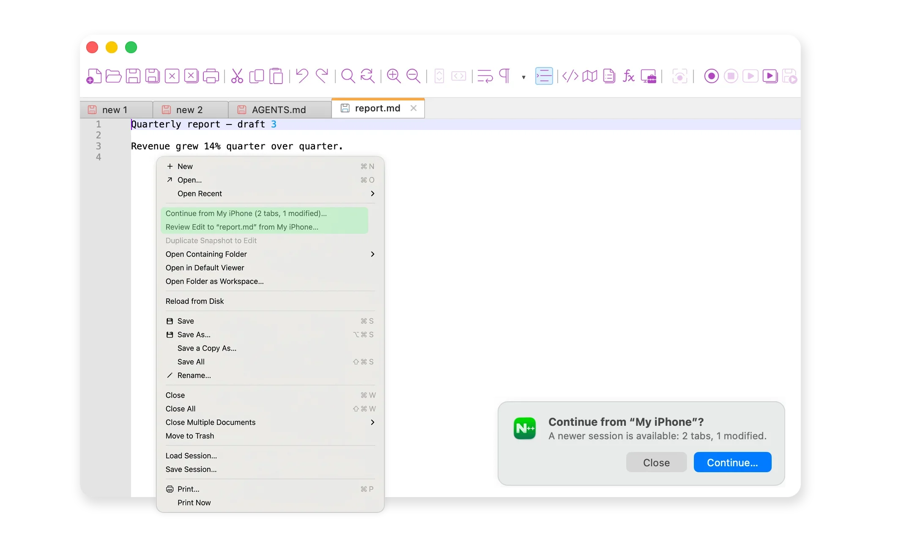
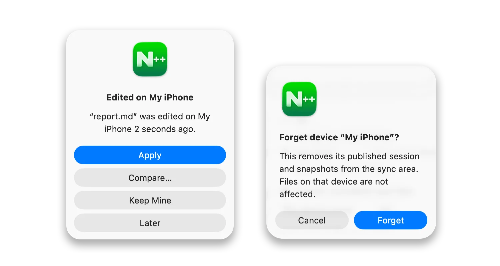
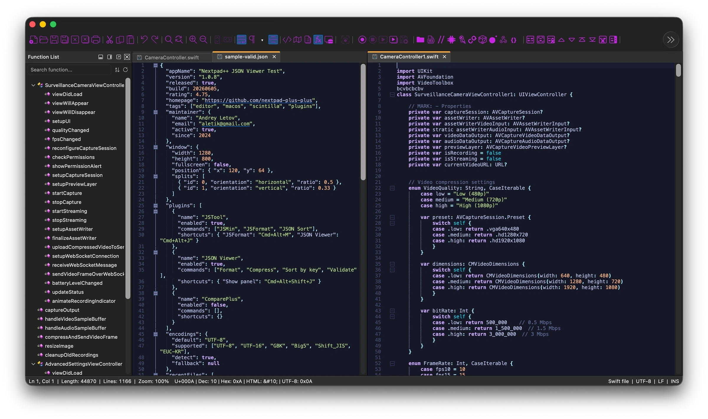

# Nextpad++ v1.1.3 — Release Notes

Successor to **v1.1.2** (October 6th, 2026). As always now, **macOS and Linux ship together, from one set of release notes** — everything below applies to both platforms unless it says otherwise. However, Linux v1.1.3 will be available for download in a week (It was delayed due to my iOS work and I'm still testing it).

Last time I promised a quiet polish release and delivered one. This time there was no such plan. 1.1.3 brings a headline feature that's been cooking for months. A whole new iOS member of the Nextpad++ family and a unified search engine, and a few extra themes. 

---

# Device Sync — your tabs, on your other machine

Here's the itch this scratches. You're working on a few files at the office with say two of them not even saved, just scratch buffers full of half-finished thoughts. You close the laptop, go home, sit down at the desktop… and your work is a Slack message to yourself away. Every note-taking app solved this years ago. Text editors mostly didn't. **Device Sync** is Nextpad++'s answer. 

 *Device Sync Setting on Mac and iPad*

Turn it on, point it at a shared place — **iCloud is the easy choice**, but any folder that syncs will do, Dropbox included — and each of your machines quietly publishes what it has open: which tabs, where your cursor was, *including unsaved work*.

Then, on other macOS, Linux, or iOS, the **File** menu grows a new item:

**Continue from iPhone (2 tabs, 1 modified)…**

 *The Continue from… menu item and message*

One click, one confirmation, and you're where you left off. Files that exist on both machines open in place, cursor restored. Unsaved buffers arrive as snapshots, clearly badged *"— from MacBook Pro"*, so you always know what you're looking at. And if a newer session shows up while you're working, a small card offers it — dismiss it and it stays dismissed.

It goes further than read-only, too. Edit one of those roamed snapshots, save it, and your edits **travel back**: the originating machine gets asked — Apply, Compare, or Keep Mine — the next time that tab has your attention. Finish on the desktop what you started on the laptop, and the laptop finds out.

 *Pop-up dialogs*

A few words on how it's built, because a feature that touches your files should earn its trust:

- **It's off by default.** Until you flip the master switch in **Preferences → Device Sync**, the feature contributes exactly nothing to how Nextpad++ reads and writes your files.
- **Nothing leaves your machines** except into the folder *you* chose. There's no account, no server of mine, no telemetry. iCloud or your Dropbox do the carrying; Nextpad++ just writes files there. It's engineered so that when anything unexpected happens, your files stay exactly as they were.

**I will publish a very detailed document specifically on Device Sync and its troubleshooting shortly**. 

---

# And a new device to sync with: Nextpad++ for iPhone and iPad

The sync format was designed from day one for screens smaller than a Mac's — and here's why: **Nextpad++ is now on iOS and iPadOS.** 

 *Nextpad++ on iPhone and iPad*

It's a real Nextpad++ with the same Scintilla engine, the same syntax highlighting, UDL Admin, the same themes. And it speaks Device Sync natively: open your tabs on the train, pick them up on the Mac at your desk, send your edits back the other way. The subway test. Start a thought on the phone, finish it on the desktop, have it waiting on the phone again.

Nextpad++ for iOS has a growing number of plugins to mimic plugins we have on iOS and Linux. More will be added with every new iOS version release. Some non-MIT license plugins I have to write from scratch.

**I set a small one-time $ fee for the iOS (iPhone + iPad) app to cover some costs to help me keep everything else I release free.** One time fee covers all updates and future releases forever. You are not only getting iOS app but contributing to all free applications, plugin development and porting, server costs, maintenance, and some new free enterprise-level apps I'm planning to release in early 2027 at [tailrace.ai](https://tailrace.ai). I'm super super greatful for your support. It allows me to move forward.

**You load a separate detailed help manual for iOS Nextpad++ shortly.** 

---

# Search: one engine, and a lot more speed

The deepest change in 1.1.3 is one you can't see. As of this release, every search box in Nextpad++, the editor's Find, Find in Files, Projects runs on **one regular-expression engine: Boost**, the same engine Windows Notepad++ uses. I made it default instead of on/off setting in Preferences. A pattern now means exactly the same thing everywhere you can type it. 

Around the engine, the whole search experience moved forward:

- **Find All is dramatically faster on huge result sets.** A user report with 1.67 million matches prompted a deep performance pass on the results panel — the same search now lands about **ten times faster**. On my test file, a million matches arrive in under two seconds.
- **Find in Files is cancellable** — the button that started the search turns into *Cancel* (Esc works too) — **and it now reads files in their own encodings.** Latin-1 logs, Shift-JIS sources: searchable, and replaceable, with every byte respected.
- **Replace in Files works with your open tabs (and your Undo).** If a matched file is open, the replacement happens *in the tab* — visible, saved in the file's own encoding, and undoable as one step.
- **The Find window's status line** ("Reached the end of the document", "Can't find the text…") now takes its colors from two dedicated **Style Configurator** entries — tune them like any other style — and stays fully legible in dark mode.
- **Case conversion grew up.** UPPER/lower/Proper/Sentence/iNVERT now apply to every selection when you've made several — rectangular blocks included — and handle accented and non-Latin text throughout. In the same family, **sorting a rectangular selection** now sorts by the column you selected, exactly as Windows Notepad++ does.

---

# Themes and colors: the promised pair, and richer everything

The 1.1.2 notes promised dark themes that VS Code and Sublime folks would feel at home in. Delivered: **Tokyo Night** and **Tokyo Night Light** join the bundled collection re-drawn for Nextpad++'s stylers.

 *Tokyo Night*

Beyond the new pair, this cycle put real depth into how code gets colored:

- **About fifty languages picked up richer highlighting.** Keyword categories the themes always defined  types versus instructions versus structure are now fully wired through to the lexers, the way Windows Notepad++ does it. Code you look at every day may gain a few colors. That's intentional, and it's an upgrade.
- **TypeScript now has its own colors in every bundled theme**, and C, Objective-C and TypeScript each have their own sections in the Style Configurator, so each can be tuned independently of C++.
- **Theme colors render with exact fidelity** — every color is read and written in sRGB end to end, so the hex in your theme file is precisely the color on your screen.
- **The editor follows dark mode from the very first frame** — launch while dark and the theme is right from the start; flip the system appearance and the editor re-themes live.
- **Smarter font handling:** if a theme names a font that isn't installed, you get Menlo — clean and readable — and all 22 bundled themes now share consistent default-font behavior.

**User Defined Languages** moved forward on several fronts: an installed UDL now **takes precedence for the file extensions it claims** — your custom language asking for `.log` gets `.log`, matching Windows; the Style Configurator gained **keyword list boxes**, so lexers that accept user keywords can be extended right from the dialog; and UDLs designed on light backgrounds now blend gracefully into dark mode.

---

# Plugins: a better host, and new faces in the catalog

Not a huge shipping cycle for plugins by count (I will be releasing a dozen new ported ones in 2 weeks) — but a meaningful one in two other ways.

**The app became a much better host.** Three upgrades every plugin benefits from:

- **Plugin keyboard shortcuts now appear automatically.** When a plugin declares default shortcuts, they show up in its menu on install — conflicts resolved sensibly (your own customizations, and the app's shortcuts, always take precedence), and combos that would interfere with normal typing are left out.
- **Plugins can drive the whole app.** The command bridge plugins use to trigger app functions grew from a handful of commands to **162** — which unlocks, among other things, ComparePlus's *Move to Other View* and NppVim's full command repertoire.
- **More room for plugin highlights and markers.** The space plugins draw their text-highlight and margin-marker slots from has been expanded and organized to mirror the Windows layout — plenty of headroom for a growing catalog.

**In the catalog**, new community-authored plugins joined through the trusted-builder pipeline — the source is audited at a specific revision, then built, signed and notarized by me, so what you install is exactly what was reviewed. **WritingAssistant**, a helper for prose, is the newest arrival through that door.

And among the updates, two stand out: **NppBeads** gained a **3D graph** of your issues and their dependencies. It has advanced filters and edit/create beads functionality and very useful for complex AI work. Eventually I see it becoming like Jira. Read about it here https://nextpad.org/news/?slug=beads-v2. **ADIFLint** had a sprint of a month; ham-radio operators, your ADIF log linting is now at 1.10 and it's a very advanced plugin develped by Andrew Blessing. Meanwhile **Plugins Admin** learned to show each plugin's **true minimum macOS version**, so the catalog is honest about what runs where.

 *Updated Beads Viewer*

---

# The everyday file

**Your unsaved work now survives anything.** Unsaved tabs were already restored after a normal quit; now periodic snapshots mean they come back after a force quit, a crash, or a battery dying mid-sentence — you lose seconds of typing, not the buffer.

**The status bar scales with your zoom.** Zoom the editor in and the status text grows to match, so "Ln 1,204, Col 7" is readable from the same distance as your code — with better contrast in dark mode, too.

**VoiceOver reads the tab bar.** Tabs announce themselves properly — name, position, selected state — and can be switched and closed from VoiceOver. Accessibility work continues; this was the most-requested piece.

**For macOS Golden Gate (27.2):** Apple adjusted toolbar layout metrics in 27.2, and Nextpad++ now manages its own toolbar spacing there — buttons, groups and dividers keep their familiar, even rhythm on the newest macOS just as they do everywhere from Big Sur up.

**Assorted, in one breath:** a new preference to **exit the app when the last tab closes** (a Windows favorite); **middle-click closes tabs** (alongside the double-click-close preference); the unsaved-changes dot wears a **redesigned, more legible icon**; opened files land precisely at line 1; the Command Palette's breadcrumbs now show the real menu trail for every command; *Hash from files* results follow each document's own line endings; long URLs in cloned views scroll smoothly; and if a session file has gone missing on disk, you get a clearly-marked placeholder tab, so your session adds up.

---

# 137 languages, 145 new strings

Localization had some updates since 1.1.0: roughly **145 newly translated strings** landed across all 136 non-English language files — covering the new Device Sync pane, the accessibility work.

The macOS and Linux builds share one set of language catalogs, and as of this release the shared catalogs cover **everything the Linux build displays**.

However, localization is always tricky and if your language shows something odd, a single screenshot in an issue is enough — the Chinese, Japanese and German reports from past releases have all led to improvements within a cycle.

---

# What's next

The plugin pipeline is far from empty and the next batch of ports is already built and in testing. Device Sync will keep growing into its role now that there's a phone and iPad in the family. Also in 2027, I'm planning to welcome code name Onyx into Nextpad++, which will make it fully compatible/have Obsidian capabilities with few advantages for AI developmnt and only with a super small size addition.    

---

# Thanks to our contributors

This release leans on community code more than any before it. **Adrian Curtin** had an outstanding cycle — eleven commits landed here, across four fronts: the user-defined keyword support, the whole Document Map color series, the dark-mode-at-launch behavior, and the plugin ID groundwork that made the catalog headroom possible. **chocholom** was right behind with four pull requests ported this cycle, spanning the multi-selection case work, rectangular sorting, the hash line-ending behavior, and the groundwork for plugin shortcuts. **Shri Saran Raj N** improved the Command Palette breadcrumbs and Preferences alignment. And the reporters: the 1.67-million-match performance report, the dark-mode Find-status screenshot, the VoiceOver feedback — each one shaped something above. The trackers are open: https://github.com/nextpad-plus-plus/nextpad-plus-plus-macos/issues for the Mac and https://github.com/nextpad-plus-plus/nextpad-plus-plus-linux/issues for Linux.

---

# Compatibility

**macOS**

- **Deployment target: macOS 11.0+ (Big Sur)** — yes, that's one *lower* than before; Macs going back to 2013 are invited. Universal binary (Apple Silicon + Intel), and already tuned for macOS Golden Gate 27.2 at the other end.
- **macOS Tahoe (26)**: the Liquid Glass look remains opt-in; Classic stays the default.

**Linux**

Version 1.1.3 to match macOS will be released in a week. I'm still testing it.

**iOS / iPadOS**

Version 1.0.0 currently in the appstore. It will grow and improve including plugins to follow macOS and Linux. If you experience issues with it, something doesn't work as you expect, clunky, or you want a new feature, go https://nextpad.org/feedback/ and send me a message. I will likely be adding the Parakeet Nextpad++ plugin there so you can use Nextpad+ on iPhone/iPad to transcribe, translate etc..   

**All platforms**

- **Plugins**: fully backward-compatible — everything built for 1.1.x keeps working unchanged. One visible (and intended) difference: plugins that declare default keyboard shortcuts now show them in their menus.
- **Saved settings** (`config.xml`, `shortcuts.xml`, themes, UDLs) are read unchanged; nothing to migrate. Device Sync adds settings of its own but, being off by default, changes nothing until you say so.
- **`npp` terminal editor**: still 0.9.1, still opt-in on macOS, unchanged this cycle.

---

*Nextpad++ is the full parity native port of Notepad++ — built fresh on Scintilla and Lexilla, in Objective-C++ on the Mac, in C on GTK 4 for Linux, and now reaching iPhone and iPad — with everything each platform expects: full menu bar, native Find/Replace, dark mode, 137 UI languages, and a curated plugin catalog. This release it learned to follow you from machine to machine. It seemed like the least a text editor could do.*
